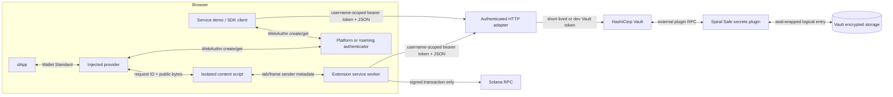
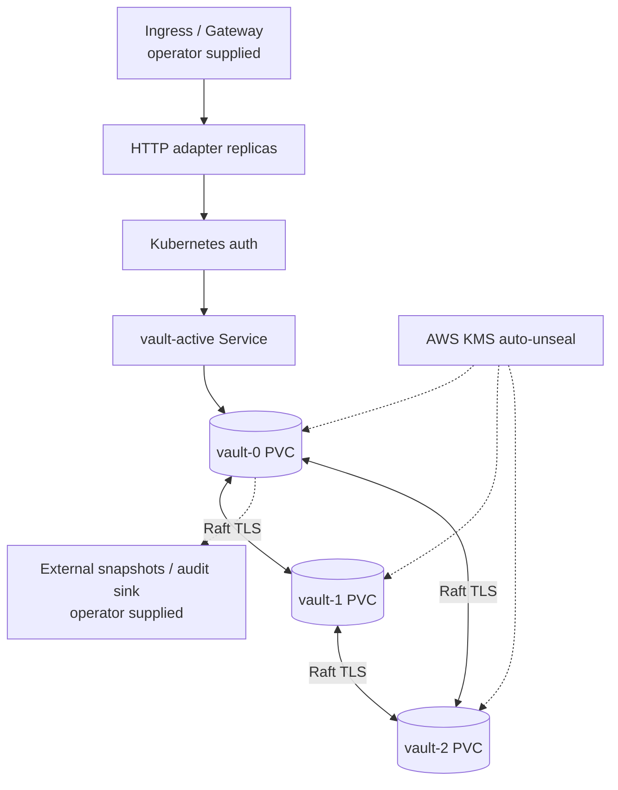

# Architecture

## System overview

The implemented core is a WebAuthn-authorized signing service. Applications
never need a Vault credential or wallet private key.



The service demo and TypeScript SDK are alternative clients of the same HTTP
contract. The browser extension is Solana-specific; Ethereum is exposed through
the service demo and SDK.

## Security and trust boundaries

| Boundary | Data allowed to cross | Data that must not cross |
| --- | --- | --- |
| dApp ↔ injected provider | account address, unsigned payload, WebAuthn options, serialized authenticator response, signed result | API bearer token, Vault token, wallet private key |
| injected page ↔ content script | versioned bridge messages with page-generated request IDs | extension storage or privileged Chrome APIs |
| content script ↔ service worker | validated request plus browser-supplied tab/frame/origin identity | caller-selected sender identity |
| service worker ↔ HTTP service | exact allowlisted-origin request, tenant/username-scoped bearer token, user/chain/operation/payload | Vault credentials and private keys |
| HTTP service ↔ Vault | server-injected tenant and a least-privilege Vault token | caller-provided tenant or Vault token |
| Vault ↔ plugin storage | gob-encoded wallet, credential, and bounded ceremony state | plaintext storage outside Vault's barrier |
| enclave ↔ EC2 parent | Veil tunnel, TLS/attestation material, encrypted application traffic | unprotected Vault state, recovery keys, embedded cloud credentials |

The extension injects its discoverable provider into top-level HTTP(S) pages,
but the background worker rejects operations unless the browser-reported exact
origin is in the extension configuration. The content script also checks
same-window and same-origin messages, caps serialized requests, and correlates
responses. These controls reduce confused-deputy risk; they do not make an
allowlisted dApp trustworthy.

The extension keeps non-secret configuration in `chrome.storage.local`. It
keeps the service bearer token and ephemeral ceremony bindings in
`chrome.storage.session`, restricted to trusted extension contexts. Persisting
the binding across service-worker suspension lets a passkey prompt complete
without moving it into page or durable local storage. The service worker alone
uses the token. Browser-session storage is an exposure reduction, not a hardware
secret store.

Page-facing `config.get` responses omit the bearer token and ceremony state.
They also reduce backend and RPC URLs to their origins, because provider/API
keys are commonly embedded in URL paths. The full URLs remain available only
to the trusted service worker for network requests.

## Identity and authorization model

Every wallet record is identified by:

```text
authenticated tenant / username / chain
```

In production, each HTTP bearer token maps to an operator-configured principal
of the form `{tenant, users:[...]}`. The service injects the tenant and checks
the requested username against that token's non-empty allowlist before calling
Vault; a body-selected tenant is ignored and an unauthorized username returns
403 without reaching Vault. Development mode may intentionally use a
tenant-wide wildcard for the disposable local token. Usernames and tenant
identifiers are limited to 1–64 characters from `A-Z a-z 0-9 . _ @ -`; the
first character must be alphanumeric. Supported chains are `solana` and
`ethereum`.

The plugin derives the WebAuthn user handle as a deterministic SHA-256 digest
of tenant, username, and chain, encoded as 43-byte base64url. This keeps the
handle inside WebAuthn's 64-byte limit while preserving identity and chain
separation.

The username allowlist closes the prototype's arbitrary-username access, but a
static application token is not a human session. OIDC/session issuance,
rotation and revocation, recovery, delegated administration, and centralized
rate limiting remain product work.

## Registration ceremony

```mermaid
sequenceDiagram
    participant P as Page/provider
    participant E as Extension worker
    participant A as HTTP adapter
    participant V as Vault plugin
    participant W as WebAuthn authenticator

    P->>E: registration.begin
    E->>A: POST /init {username, chain}
    A->>V: users {tenant, username, chain}
    V->>V: Create chain key if absent
    V->>V: BeginRegistration; store expiring ceremony
    V-->>P: address, options, ceremonyId
    P->>W: navigator.credentials.create(options)
    W-->>P: attestation credential
    P->>E: registration.complete {ceremonyId, credential}
    E->>E: Verify tab/frame/origin/user/chain binding
    E->>A: POST /create
    A->>V: users {tenant, username, chain, ceremonyId, credential}
    V->>V: Consume ID; validate attestation; persist credential
    V-->>P: address and chain
```

The plugin generates a 32-byte random, base64url ceremony ID. A ceremony
expires after two minutes, is single-use, and is removed before
attacker-controlled credential validation. Up to eight pending ceremonies are
kept per wallet; expired entries are pruned when another begins. Consuming
before validation prevents retries and replay at the cost of requiring a fresh
ceremony after malformed or cancelled completion.

The WebAuthn configuration requires user verification. Registration and
authentication options request it, and an assertion carrying only user
presence cannot release a signature.

The key is created at `/init`, before registration finishes. An incomplete
record cannot sign and `/check` returns a conflict rather than treating it as
registered.

## Signing ceremony

```mermaid
sequenceDiagram
    participant P as Page/provider
    participant E as Extension worker
    participant A as HTTP adapter
    participant V as Vault plugin
    participant W as WebAuthn authenticator
    participant R as Solana RPC

    P->>E: sign.begin {operation, payload}
    E->>A: POST /signin {username, chain, operation, payload}
    A->>V: auth {tenant, username, chain, operation, payload}
    V->>V: BeginLogin; bind payload to ceremonyId
    V-->>P: address, options, ceremonyId
    P->>W: navigator.credentials.get(options)
    W-->>P: assertion credential
    P->>E: sign.complete {ceremonyId, credential}
    E->>E: Verify original browser binding
    E->>A: POST /complete
    A->>V: auth {tenant, username, chain, ceremonyId, credential}
    V->>V: Consume ID; validate assertion; update sign counter
    V->>V: Select chain signer and sign bound payload
    V-->>P: encodedTX or signature
    opt Wallet Standard sign-and-send
        E->>R: sendTransaction(signed transaction)
        R-->>P: network signature
    end
```

The pending operation and payload live inside the server-issued ceremony, not a
single mutable user-level slot. Concurrent tabs therefore receive distinct
challenges and cannot complete each other's extension ceremony. The plugin
also rejects replay after an ID has been consumed. It persists the
authenticator's updated signature counter. If a previously nonzero counter
regresses, the credential is persisted with a clone warning, the current
request fails before signing, and future authentication starts remain blocked.
Credential recovery or replacement is not implemented yet.

WebAuthn proves control of the registered authenticator and binds the browser
origin/challenge. It does not currently render or cryptographically bind a
human-readable transaction explanation. Transaction decoding, simulation, and
policy checks remain necessary before production custody.

## Chain abstraction

The Go `ChainSigner` interface separates:

1. key generation;
2. address derivation;
3. operation-specific signing.

The WebAuthn and storage code selects a signer by chain, so another chain can be
added without duplicating ceremony handling.

| Chain | Key/address | Implemented operations | Current boundary |
| --- | --- | --- | --- |
| Solana | Ed25519; base58 public key | legacy transaction signing; raw message signing | malformed encodings return validation errors; versioned transactions are explicitly rejected and not advertised |
| Ethereum | secp256k1; EIP-55 address | EIP-191 personal-message signing | no transaction, typed-data, EIP-155 replay protection, fee, nonce, or broadcast support |

Ethereum signatures are returned as standard-base64 `R || S || V`, with a
recovery ID `V` restricted to 0 or 1. Solana message signatures are
standard-base64 64-byte Ed25519 signatures. Signed Solana transactions are
returned in `encodedTX`. A panic boundary around the upstream Solana parser
turns truncated or panic-shaped caller bytes into a normal signing error rather
than terminating the Vault plugin process.

## Vault storage model

The plugin stores one gob-encoded `Payload` at:

```text
tenants/<base64url tenant>/users/<base64url username>/chains/<base64url chain>
```

The payload contains:

- chain private-key bytes and derived address;
- the WebAuthn user and registered credentials, including updated sign counts;
- a map of registration or authentication ceremonies, their expiry, and any
  pending signing request;
- legacy fields retained only so the Go type can decode the old shape.

Logical storage entries request `SealWrap: true`. Vault's storage barrier is
the primary at-rest control; seal wrapping only adds protection when the
configured seal supports it.

The original prototype stored records under `<Vault client token>/<username>`.
The new tenant/user/chain path deliberately does not read those entries. There
is no automatic migration; old development wallets must be exported through a
reviewed one-off process or re-registered.

## Deployment modes

### Disposable local Compose

Compose runs one Vault dev server, one HTTP adapter, and one browser demo.
Vault uses in-memory storage and the known root token `root`; the API uses a
known development bearer token. Published host ports are loopback-only, and
the service/client images run without root; this mode is still for onboarding
and tests only.

The local demo serves bundled JavaScript and CSS without CDN dependencies,
renders errors as text, and sets a restrictive CSP and related browser security
headers. It will call only a plain-HTTP loopback API origin whose hostname
matches the page hostname. Its Solana example may still call the configured
devnet RPC. Both Node images use the same pinned Node 22 image digest.

### Kubernetes production baseline



The production Kustomize overlay uses a three-replica Vault StatefulSet with
integrated Raft, retained data/audit PVCs, peer and active services, TLS,
anti-affinity, a disruption budget, restricted pod security, Kubernetes
service registration/auth, and AWS KMS auto-unseal inputs. It keeps two API
replicas and explicitly deletes the local demo's Deployment, Service, and
disruption budget; the Skaffold production profile also removes the client
image artifact. A reviewed external relying-party application and TLS
Ingress/Gateway must be supplied by the operator.

Raft membership is intentionally controlled. A new node needs the StatefulSet
identity, trusted TLS material, KMS workload identity, network access, and
quorum-approved join path. “Anyone can run a node” would let an attacker copy
custody data and is incompatible with this trust model. Independent operators
require an explicit admission, certificate, attestation, governance, and
removal protocol.

Vault [integrated storage](https://developer.hashicorp.com/vault/docs/concepts/integrated-storage)
is used instead of adding Consul as a second distributed system. Stateful
identity and retained volumes follow the Kubernetes
[StatefulSet](https://kubernetes.io/docs/concepts/workloads/controllers/statefulset/)
and [persistent-volume](https://kubernetes.io/docs/concepts/storage/persistent-volumes/)
models.

### Veil on AWS Nitro Enclaves

The `services/nitro` adapter replaces the historical Nitriding dependency
with [Amnesic Systems Veil](https://github.com/Amnesic-Systems/veil):

- `veil-daemon` runs inside the enclave and exposes attested TLS on 8443;
- Vault listens only on enclave loopback;
- `veil-proxy` runs with host networking privileges on the EC2 parent;
- `veil-verify` is exported as a relying-party tool.

Veil is not a drop-in Nitriding binary. The image adapter builds the components
and wires readiness/proxying, but persistence, initialization, recovery
material delivery, KMS binding, independent attestation verification, and
full EC2 lifecycle tests remain unresolved. Nitro Enclaves have no persistent
storage, so the in-enclave Raft directory is disposable. The durable
Kubernetes Raft topology is separate; the two modes are not yet combined.

Veil is GPL-3.0-only. Distribution must preserve notices, source/build
correspondence, and any applicable source-offer obligations, with legal review.
The pinned Vault image has its own BUSL terms.

## Non-runtime repositories

`.github`, `specs`, `token-list`, and `website` are outside the signing
runtime. The website is a legacy Hugo marketing site; the token list is an
inherited Jupiter data-validation fork and is not consumed by any signer.
Their status and branch history are recorded in
[REPOSITORY-INVENTORY.md](REPOSITORY-INVENTORY.md).
