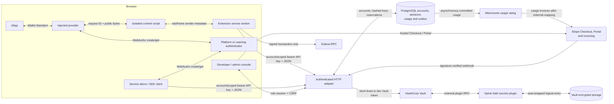
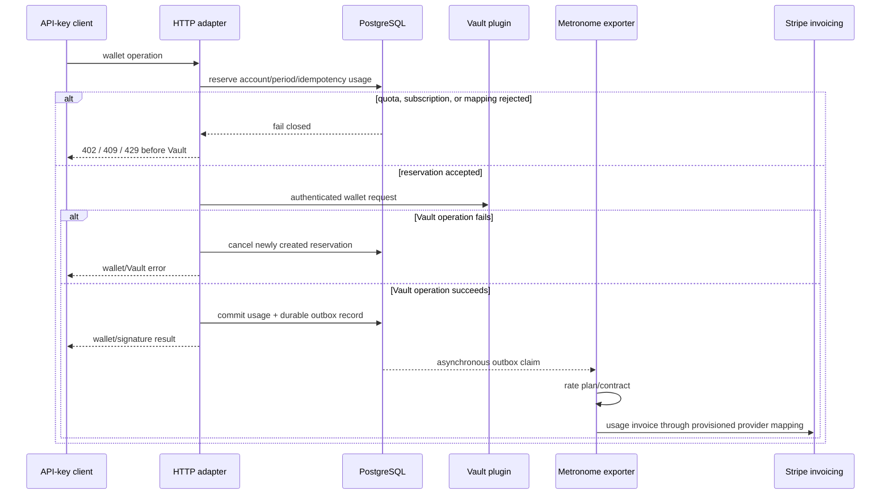
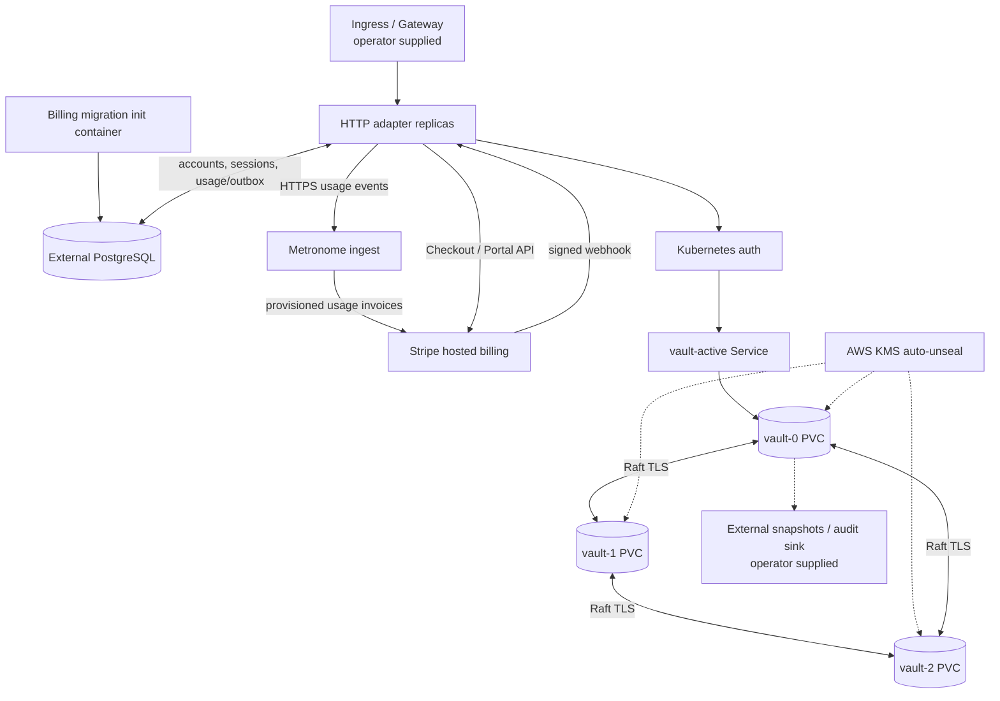

# Architecture

## System overview

The implemented core is a WebAuthn-authorized signing service. Applications
never need a Vault credential or wallet private key.



The service demo and TypeScript SDK are alternative clients of the same wallet
HTTP contract. The developer/admin HTML consoles use a separate session
contract. The browser extension is Solana-specific; Ethereum is exposed through
the service demo and SDK. Metronome and Stripe are billing dependencies, never
part of the cryptographic signing path.

## Security and trust boundaries

| Boundary | Data allowed to cross | Data that must not cross |
| --- | --- | --- |
| dApp ↔ injected provider | account address, unsigned payload, WebAuthn options, serialized authenticator response, signed result | API bearer token, Vault token, wallet private key |
| injected page ↔ content script | versioned bridge messages with page-generated request IDs | extension storage or privileged Chrome APIs |
| content script ↔ service worker | validated request plus browser-supplied tab/frame/origin identity | caller-selected sender identity |
| service worker ↔ HTTP service | exact allowlisted-origin request, tenant/username-scoped bearer token, user/chain/operation/payload | Vault credentials and private keys |
| console browser ↔ HTTP service | password login, opaque server-side session cookie, CSRF token, account/usage metadata, one-time API-key reveal | Vault token, wallet key, another role/account selected by the browser |
| HTTP service ↔ Vault | server-injected tenant and a least-privilege Vault token | caller-provided tenant or Vault token |
| HTTP service ↔ PostgreSQL | accounts, role users, hashed API keys/session tokens, plans, reservations, usage/outbox and Stripe identifiers | plaintext API-key/session secrets and wallet private keys |
| outbox ↔ Metronome | stable transaction ID, customer alias, event type, RFC3339 time, string-valued usage properties | signing payload, WebAuthn credential, wallet private key |
| Stripe ↔ HTTP service | hosted Checkout/Portal URL, signed webhook, account/plan metadata, customer/subscription state | API-key pepper, session secret, wallet key, unverified webhook body |
| Vault ↔ plugin storage | gob-encoded wallet, credential, and bounded ceremony state | plaintext storage outside Vault's barrier |
| enclave ↔ EC2 parent | Veil tunnel, TLS/attestation material, encrypted application traffic | unprotected Vault state, recovery keys, embedded cloud credentials |

The extension injects its discoverable provider into top-level HTTP(S) pages,
but the background worker rejects operations unless the browser-reported exact
origin is in the extension configuration. The content script also checks
same-window and same-origin messages, caps serialized requests, and correlates
responses. These controls reduce confused-deputy risk; they do not make an
allowlisted dApp trustworthy.

The extension keeps non-secret configuration in `chrome.storage.local`. It
keeps the service bearer token and ephemeral ceremony bindings in
`chrome.storage.session`, restricted to trusted extension contexts. Persisting
the binding across service-worker suspension lets a passkey prompt complete
without moving it into page or durable local storage. The service worker alone
uses the token. Browser-session storage is an exposure reduction, not a hardware
secret store.

Page-facing `config.get` responses omit the bearer token and ceremony state.
They also reduce backend and RPC URLs to their origins, because provider/API
keys are commonly embedded in URL paths. The full URLs remain available only
to the trusted service worker for network requests.

## Identity and authorization model

Every wallet record is identified by:

```text
authenticated tenant / username / chain
```

The wallet API and account consoles deliberately use different credentials:

- with production billing enabled, a bearer API key resolves a PostgreSQL
  account, tenant, non-empty username allowlist, and any combination of
  `wallets:read`, `wallets:write`, and `signatures:create`; the key is revealed
  once and only an HMAC-SHA-256 digest under `API_KEY_PEPPER` is stored;
- the legacy operator-supplied `{tenant, users:[...]}` token map remains for a
  billing-disabled deployment, and the disposable development profile has a
  known tenant-wide token; production billing rejects every static token map;
- developer and admin browsers authenticate with password-derived, server-side
  sessions. The opaque random token is held in an HttpOnly, SameSite=Strict,
  Secure-in-production cookie and its keyed hash is stored. A session is not
  accepted as wallet API bearer authorization.

The service injects the authenticated tenant, enforces API-key scope, and
checks the requested username before calling Vault; a body-selected tenant is
ignored and an unauthorized username returns 403 without reaching Vault.
Inactive accounts and unverified usage-invoicing mappings fail before Vault
with 402. Development mode may intentionally use a tenant-wide wildcard for
the disposable local token. Usernames and tenant identifiers are limited to
1–64 characters from `A-Z a-z 0-9 . _ @ -`; the first character must be
alphanumeric. Supported chains are `solana` and `ethereum`.

The plugin derives the WebAuthn user handle as a deterministic SHA-256 digest
of tenant, username, and chain, encoded as 43-byte base64url. This keeps the
handle inside WebAuthn's 64-byte limit while preserving identity and chain
separation.

The account console now supplies developer/admin roles and API-key creation and
revocation, but it is a password-based product-local identity store. A separate
operator CLI can create or rotate an account-independent admin from a mounted
password file; it rejects plaintext password arguments and cannot promote a
developer. SSO/OIDC, MFA, forced password change/reset, wallet recovery,
delegated approvals, centralized rate limiting, and a complete identity
lifecycle remain product work.

## Account, subscription, and usage flow

Plans define a base Stripe Product/Price, an active-wallet limit and operator
estimate, a signed-transaction limit and estimate, and distinct Metronome
Product/rate-card IDs. The checked-in `sandbox`, `launch`, and `scale` plans are
zero-price memory fixtures, not production pricing.



`/create`, `/check`, and `/signin` reserve `active_wallet`; the idempotency key
is the account billing-period start plus a domain-separated HMAC-SHA-256 of
tenant, username, and chain under the billing pepper. Only the first successful
action for that wallet in the period is
committed. For `operation=transaction`, `/complete` reserves
`transaction_signed` with the single-use ceremony ID, so a successful
transaction signature commits exactly one transaction unit. Message signatures
do not consume transaction units. Vault compares the requested completion
operation to the operation stored with the ceremony before signing and returns
that trusted value; the adapter also requires an exact match before exposing
output or committing usage. Transaction reservations count toward quota. A
newly created reservation is cancelled if Vault rejects the operation or the
returned operation differs; a stale reservation is discarded after the
configured TTL. If Vault succeeds but commit fails, the request fails and the
reservation stays intact instead of being falsely cancelled; the signature
result is not returned. If the process dies in that window, the system
eventually underbills rather than inventing a charge from ambiguous state;
reconciliation is still an operator procedure. Message completion relies on
Vault's one-time ceremony replay protection rather than the billing reservation
gate. A missing or expired local billing period fails closed with 402 until a
verified Stripe webhook refreshes it.

Commit and outbox insertion are one PostgreSQL statement. The exporter does not
block signing: it sends 1–100 stable `spiral_active_wallet` or
`spiral_transaction_signed` events, retries network/429/5xx responses with
bounded backoff, and dead-letters other 4xx responses. Metronome ingest alone
does not create a Stripe charge. The external per-account
Metronome-customer/contract/rate-card to Stripe-customer mapping must be
provisioned, sandbox-invoiced, and then attested by an administrator. The store
atomically compares and snapshots the submitted Stripe customer, Metronome
ingest alias, local plan, and Metronome rate card; a change to that tuple or a
terminal subscription makes it non-current. It is still an operator assertion,
not a remote verification. Until it exists and remains current, production
requests return `402 billing_provisioning_required`.

The developer console creates hosted subscription Checkout and Customer Portal
sessions. Checkout uses one configured base Price and does not force payment
methods or automatic tax. Raw-body Stripe webhooks are signature verified,
claimed idempotently, and retrieve current subscription state before updating
the account. A subscription must contain exactly one base item whose current
Stripe Price maps uniquely to a local plan; Portal plan changes therefore use
current provider state rather than stale event metadata. No live Checkout,
webhook, invoice, tax, or charge has been executed as part of the repository
verification.

## Registration ceremony

```mermaid
sequenceDiagram
    participant P as Page/provider
    participant E as Extension worker
    participant A as HTTP adapter
    participant V as Vault plugin
    participant W as WebAuthn authenticator

    P->>E: registration.begin
    E->>A: POST /init {username, chain}
    A->>V: users {tenant, username, chain}
    V->>V: Create chain key if absent
    V->>V: BeginRegistration; store expiring ceremony
    V-->>P: address, options, ceremonyId
    P->>W: navigator.credentials.create(options)
    W-->>P: attestation credential
    P->>E: registration.complete {ceremonyId, credential}
    E->>E: Verify tab/frame/origin/user/chain binding
    E->>A: POST /create
    A->>V: users {tenant, username, chain, ceremonyId, credential}
    V->>V: Consume ID; validate attestation; persist credential
    V-->>P: address and chain
```

The plugin generates a 32-byte random, base64url ceremony ID. A ceremony
expires after two minutes, is single-use, and is removed before
attacker-controlled credential validation. Up to eight pending ceremonies are
kept per wallet; expired entries are pruned when another begins. Consuming
before validation prevents retries and replay at the cost of requiring a fresh
ceremony after malformed or cancelled completion.

The WebAuthn configuration requires user verification. Registration and
authentication options request it, and an assertion carrying only user
presence cannot release a signature.

The key is created at `/init`, before registration finishes. An incomplete
record cannot sign and `/check` returns a conflict rather than treating it as
registered.

## Signing ceremony

```mermaid
sequenceDiagram
    participant P as Page/provider
    participant E as Extension worker
    participant A as HTTP adapter
    participant V as Vault plugin
    participant W as WebAuthn authenticator
    participant R as Solana RPC

    P->>E: sign.begin {operation, payload}
    E->>A: POST /signin {username, chain, operation, payload}
    A->>V: auth {tenant, username, chain, operation, payload}
    V->>V: BeginLogin; bind payload to ceremonyId
    V-->>P: address, options, ceremonyId
    P->>W: navigator.credentials.get(options)
    W-->>P: assertion credential
    P->>E: sign.complete {ceremonyId, credential}
    E->>E: Verify original browser binding
    E->>A: POST /complete {operation, ceremonyId, credential}
    A->>V: auth {tenant, username, chain, operation, ceremonyId, credential}
    V->>V: Consume ID; require stored operation match; validate assertion; update sign counter
    V->>V: Select chain signer and sign bound payload
    V-->>A: stored operation + encodedTX or signature
    A->>A: Require operation match; commit transaction usage when applicable
    A-->>E: encodedTX or signature
    E-->>P: encodedTX or signature
    opt Wallet Standard sign-and-send
        E->>R: sendTransaction(signed transaction)
        R-->>P: network signature
    end
```

The pending operation and payload live inside the server-issued ceremony, not a
single mutable user-level slot. Concurrent tabs therefore receive distinct
challenges and cannot complete each other's extension ceremony. The plugin
also rejects replay after an ID has been consumed. It persists the
authenticator's updated signature counter. If a previously nonzero counter
regresses, the credential is persisted with a clone warning, the current
request fails before signing, and future authentication starts remain blocked.
Credential recovery or replacement is not implemented yet.

WebAuthn proves control of the registered authenticator and binds the browser
origin/challenge. It does not currently render or cryptographically bind a
human-readable transaction explanation. Transaction decoding, simulation, and
policy checks remain necessary before production custody.

## Chain abstraction

The Go `ChainSigner` interface separates:

1. key generation;
2. address derivation;
3. operation-specific signing.

The WebAuthn and storage code selects a signer by chain, so another chain can be
added without duplicating ceremony handling.

| Chain | Key/address | Implemented operations | Current boundary |
| --- | --- | --- | --- |
| Solana | Ed25519; base58 public key | legacy transaction signing; raw message signing | malformed encodings return validation errors; versioned transactions are explicitly rejected and not advertised |
| Ethereum | secp256k1; EIP-55 address | EIP-191 personal-message signing | no transaction, typed-data, EIP-155 replay protection, fee, nonce, or broadcast support |

Ethereum signatures are returned as standard-base64 `R || S || V`, with a
recovery ID `V` restricted to 0 or 1. Solana message signatures are
standard-base64 64-byte Ed25519 signatures. Signed Solana transactions are
returned in `encodedTX`. A panic boundary around the upstream Solana parser
turns truncated or panic-shaped caller bytes into a normal signing error rather
than terminating the Vault plugin process.

## Vault storage model

The plugin stores one gob-encoded `Payload` at:

```text
tenants/<base64url tenant>/users/<base64url username>/chains/<base64url chain>
```

The payload contains:

- chain private-key bytes and derived address;
- the WebAuthn user and registered credentials, including updated sign counts;
- a map of registration or authentication ceremonies, their expiry, and any
  pending signing request;
- legacy fields retained only so the Go type can decode the old shape.

Logical storage entries request `SealWrap: true`. Vault's storage barrier is
the primary at-rest control; seal wrapping only adds protection when the
configured seal supports it.

The original prototype stored records under `<Vault client token>/<username>`.
The new tenant/user/chain path deliberately does not read those entries. There
is no automatic migration; old development wallets must be exported through a
reviewed one-off process or re-registered.

## Deployment modes

### Disposable local Compose

Compose runs one Vault dev server, one HTTP adapter, and one browser demo.
Vault uses in-memory storage and the known root token `root`; the API uses a
known development bearer token. The account layer is also in memory with
zero-price fixture plans and known developer/admin credentials; Stripe and
Metronome are disabled. Published host ports are loopback-only, and the
service/client images run without root; this mode is still for onboarding and
tests only.

The local demo serves bundled JavaScript and CSS without CDN dependencies,
renders errors as text, and sets a restrictive CSP and related browser security
headers. It will call only a plain-HTTP loopback API origin whose hostname
matches the page hostname. Its Solana example may still call the configured
devnet RPC. Both Node images use the same pinned Node 22 image digest.

### Kubernetes production baseline



The production Kustomize overlay uses a three-replica Vault StatefulSet with
integrated Raft, retained data/audit PVCs, peer and active services, TLS,
anti-affinity, a disruption budget, restricted pod security, Kubernetes
service registration/auth, and AWS KMS auto-unseal inputs. It keeps two API
replicas and explicitly deletes the local demo's Deployment, Service, and
disruption budget; the Skaffold production profile also removes the client
image artifact. A reviewed external relying-party application and TLS
Ingress/Gateway must be supplied by the operator.

The same overlay selects PostgreSQL billing and adds the idempotent billing
migration as a service init container. It intentionally leaves production plan
IDs/URLs and every database, pepper, session, Stripe, and Metronome secret to
the deployment secret system. Its checked-in
`METRONOME_STRIPE_INVOICING_VERIFIED=false` prevents a production start from
silently asserting that usage will be invoiced. The service NetworkPolicy
permits Vault, cluster DNS, a same-namespace PostgreSQL pod labeled
`spiral-safe.io/billing-database=allowed` on 5432, and a same-namespace HTTPS
gateway labeled `spiral-safe.io/billing-gateway=allowed` on 443. It does not
select Services, other namespaces, DNS names, managed databases, Stripe, or
Metronome directly. Provider-specific egress and database routing must be
supplied and reviewed for the target cluster.

The checked-in init container and service currently consume the same
`DATABASE_URL`. That is sufficient to run the migration but does not implement
the recommended split between a schema-owner/migration role and a narrower
runtime role. Separate those privileges before production rather than giving
every service replica DDL authority.

Raft membership is intentionally controlled. A new node needs the StatefulSet
identity, trusted TLS material, KMS workload identity, network access, and
quorum-approved join path. “Anyone can run a node” would let an attacker copy
custody data and is incompatible with this trust model. Independent operators
require an explicit admission, certificate, attestation, governance, and
removal protocol.

Vault [integrated storage](https://developer.hashicorp.com/vault/docs/concepts/integrated-storage)
is used instead of adding Consul as a second distributed system. Stateful
identity and retained volumes follow the Kubernetes
[StatefulSet](https://kubernetes.io/docs/concepts/workloads/controllers/statefulset/)
and [persistent-volume](https://kubernetes.io/docs/concepts/storage/persistent-volumes/)
models.

### Veil on AWS Nitro Enclaves

The `services/nitro` adapter replaces the historical Nitriding dependency
with [Amnesic Systems Veil](https://github.com/Amnesic-Systems/veil):

- one pinned Linux/amd64 container/EIF is used for either `bootstrap` or `join`;
- a strict, short-lived schema-v1 manifest supplies node-specific identity,
  operator-declared OCI digest plus exact EIF/source/Veil pins, unique Raft node ID, advertised addresses,
  shared auto-unseal key ID, TLS paths, minimum voter count, and explicit names
  for external storage/routing boundaries;
- `veil-daemon` exposes attestation on 8443, while Vault uses separate mTLS API
  and Raft-cluster endpoints on the Veil full-IP tunnel at 18200 and 18201;
- `veil-verify` checks fresh nonce/PCR/TLS/source correspondence before an
  external enrollment hook may return one short-lived bundle reference;
- the membership check requires initialized, unsealed AWS-KMS-sealed Vault,
  the exact node as a voter at its advertised cluster address, and healthy
  Autopilot with failure tolerance derived from the odd minimum voter count.

The renderer rejects unknown manifest fields, placeholders, unsafe or writable
trust/key files, an admission lifetime longer than 30 minutes, missing mTLS or
shared-seal requirements, wrong Veil tunnel binds, duplicate/missing leaders,
and bootstrap/join field confusion. It generates Vault configuration; it does
not make the manifest trustworthy or deliver it.

The manifest's OCI `image.digest` is syntax/placeholder checked and useful for
release inventory, but it is not derived from the running EIF or bound by the
current admission script. The external delivery/release system must bind that
value to signed provenance. Runtime admission currently rests on the separately
obtained EIF SHA-384 plus Veil's PCR, nonce, TLS-certificate, and source checks;
the local equality simulation is not proof of an OCI-to-EIF relationship.

The one measured image intentionally uses a shared `.invalid` sentinel for the
Veil listener name. `veil-verify` does not rely on ordinary CA/hostname trust:
it hashes the leaf certificate presented by the operator-routed node and
requires that hash inside fresh nonce-bound Nitro attestation before PCR
comparison. The per-node `veilAddress` is therefore a routing address, not a
generic PKI identity. Port 8443 must remain attestation-only; Vault clients use
the independent operator-CA mTLS endpoint on 18200.

This is a fail-closed admission scaffold, not a live quorum. Veil gives every
parent/enclave pair the same `10.0.0.1/10.0.0.2` subnet and supplies no
cross-host router. Nitro supplies no durable enclave block storage, and the
Nitro CLI cannot inject the runtime manifest/TLS/KMS identity into an already
attested EIF. A production voter is therefore blocked until all three exist
and pass failure testing:

1. a private per-node cross-host L4 overlay/forwarder for the unique Vault API
   and Raft addresses;
2. rollback-protected durable storage with Raft-compatible ordering, fsync,
   fencing, snapshot, restore, crash, and per-node isolation semantics; and
3. an attestation-bound delivery service for the manifest, TLS identities, and
   narrowly scoped shared auto-unseal/KMS authorization.

The local two-node simulation proves only that one image identity and KMS key
can render distinct bootstrap/join node IDs, directories, and mTLS
`retry_join`. The enrollment test uses a mock verifier, hook, Vault peer list,
and Autopilot response. Neither is evidence of Nitro isolation, a durable
voter, cross-host routing, or a live quorum. The Kubernetes Raft topology is a
separate deployment mode.

Veil is GPL-3.0-only. Distribution must preserve notices, source/build
correspondence, and any applicable source-offer obligations, with legal review.
The pinned Vault image has its own BUSL terms.

## Non-runtime repositories

`.github`, `specs`, `token-list`, and `website` are outside the signing
runtime. The website is a legacy Hugo marketing site; the token list is an
inherited Jupiter data-validation fork and is not consumed by any signer.
Their status and branch history are recorded in
[REPOSITORY-INVENTORY.md](REPOSITORY-INVENTORY.md).
