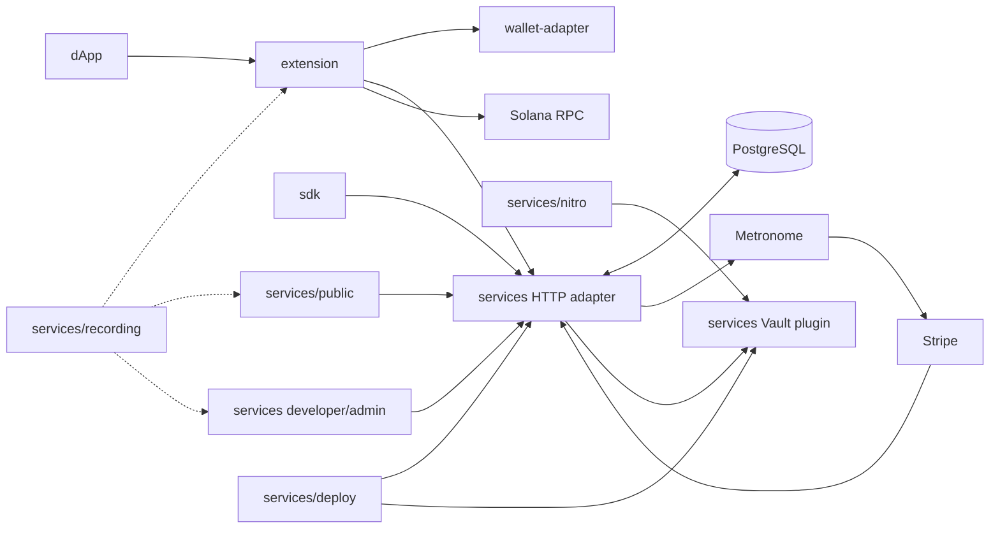

# Repository and branch inventory

Inventory date: **2026-08-30**.

The organization has eight public, non-archived repositories. All default to
`main`. The local checkouts are full clones with their remote branches and
tags. The core custody/authorization implementation is now on the remote main
branches; the account/billing, annotated-recording, and same-image Nitro work
described here remains uncommitted in `services` and `extension`, and this
reconciliation itself remains uncommitted in `specs`, at this inventory point.

## Repositories

| Repository | Remote branches / history | Role and current workspace state |
| --- | --- | --- |
| [`.github`](https://github.com/Spiral-Safe/.github) | `main`; 3 commits | Organization profile and license. Its high-availability, Consul, monitoring, audit, rotation, and production-Nitro language remains aspirational. It should link to these capability boundaries before being used as product documentation. |
| [`extension`](https://github.com/Spiral-Safe/extension) | `main`; 8 commits | Manifest V3 Solana wallet. The committed implementation replaces local/browser-held signing keys and stub methods with a Vault-backed provider, session-only API token, origin/tab/frame-bound ceremonies, page-facing URL credential redaction, real Wallet Standard methods, RPC submission, tests, popup configuration, and an extension-side demo. The workspace adds recording launch support. |
| [`sdk`](https://github.com/Spiral-Safe/sdk) | `main`; 3 commits | Low-level TypeScript HTTP client. It replaces the obsolete browser `X-Vault-Token` model with a tenant bearer token, chain/operation/ceremony fields, typed errors, URL safety checks, and route-contract tests. |
| [`services`](https://github.com/Spiral-Safe/services) | `main` (25 commits), `deployment`; 30 reachable commits total; tag `v1.0.0` | Runtime owner: Go Vault plugin, Express adapter, browser demo, Compose, tests, load harness, Skaffold/Kustomize, and Veil/Nitro. The current workspace adds PostgreSQL accounts/API keys/sessions/usage/outbox, developer/admin consoles, Stripe and Metronome integrations, migrations, annotated Playwright recordings, billing-aware deployment configuration, and strict same-image Nitro bootstrap/join admission on top of the committed multichain/WebAuthn/Vault-Raft core. |
| [`specs`](https://github.com/Spiral-Safe/specs) | `main`; 3 commits | Canonical architecture, API, inventory, runbook, security, and verification documentation. The historical repository contained a short product overview and four roadmap issues. |
| [`token-list`](https://github.com/Spiral-Safe/token-list) | `main`; 380 commits | Inherited Jupiter Universal Token List data/tooling fork. Spiral-specific history adds/renames the S2 token. It is not imported by the signer, service, extension, or SDK. |
| [`wallet-adapter`](https://github.com/Spiral-Safe/wallet-adapter) | `main`; 6 commits | Private local package that translates the injected provider into Solana Wallet Standard accounts, events, legacy-transaction, batch, sign-and-send, message, SIWS, and custom registration/configuration features. It owns no credentials or keys. |
| [`website`](https://github.com/Spiral-Safe/website) | `main`; 7 commits | Legacy Hugo marketing site with the Terminal theme pinned as a Git submodule at `7e13d24`. It is separate from both runnable demos and from the currently hosted public marketing site. |

## Runtime dependency graph

Material relationships:

1. `extension/package.json` consumes `wallet-adapter` through
   `file:../wallet-adapter`; build the adapter first.
2. The extension, SDK, and `services/public` demo all implement the same
   five-route registration/signing contract.
3. `services/load-test` targets the adapter's probes and every wallet route.
4. `services/src/billing`, `services/migrations`, and PostgreSQL own account,
   session, API-key, quota, usage, outbox, and webhook state. Metronome receives
   committed usage asynchronously; Stripe owns hosted subscription and invoice
   collection surfaces after external provisioning.
5. `services/recording` drives the actual unpacked extension, standalone wallet
   page, and built console routes with explicit loopback fixtures.
6. `services/skaffold.yaml` builds the service, client, and Vault-plugin images
   for local development. Its production profile removes the client artifact,
   and the production overlay deletes every client/demo workload.
7. `services/nitro/Dockerfile` builds the local plugin plus a pinned Veil
   revision. The same image is configured at run time as bootstrap or joiner;
   it no longer fetches the historical `deployment` branch or Nitriding.
8. `website` pins an external Hugo theme submodule.

`.github`, `specs`, `token-list`, and `website` do not participate in
the signing request path.

## Services branch topology

`services/main` and `services/deployment` share commit `cdbe171`, then
diverge by six main-only and four deployment-only commits in the cloned
history:

- remote `main` contains the newest original local setup, Go tests, generic
  byte-signing fallback, and the old Nitriding template;
- remote `deployment` contains older hosted-origin/Vault/Nitro experiments;
- the current workspace implementation is based on the `main` checkout and
  supersedes both branch-specific deployment approaches with configurable
  WebAuthn origins, chain-specific signing, Kubernetes manifests, and Veil.

Do not merge `deployment` mechanically. Review individual historical changes
against the current architecture; its hard-coded origins and old enclave
assumptions are not production configuration.

## Product areas and ownership

| Product area | Current owner | Notes |
| --- | --- | --- |
| Key custody, WebAuthn validation, chain signing | `services` Go plugin | Security-critical core |
| HTTP auth, validation, Vault client | `services/src` | Tenant boundary and error contract |
| Accounts, console sessions, API keys, plans, metering | `services/src/billing`, `services/migrations` | PostgreSQL in production; memory only for development fixtures |
| Hosted subscription and usage invoicing adapters | `services/src/billing/integrations.ts` | Stripe + Metronome; external provider mapping is operator-owned |
| Solana dApp integration | `extension` + `wallet-adapter` | Extension only supports Solana |
| Direct application integration | `sdk` | Caller performs WebAuthn browser steps |
| Interactive examples | `services/public`, `extension/demo` | Service demo also exposes Ethereum |
| Local orchestration and load checks | `services` | Compose and bounded Node runners |
| Annotated product walkthroughs | `services/recording`, `extension/recording` | Fixture-mode video/trace/screenshot artifacts |
| Kubernetes operations | `services/deploy`, `services/skaffold.yaml` | Production-intent, external inputs required |
| Nitro/attestation experiment | `services/nitro` | Veil adapter; separate from Kubernetes |
| Canonical documentation | `specs` | This repository |
| Marketing/data assets | `website`, `.github`, `token-list` | Outside runtime |

## Roadmap issues versus workspace implementation

| Issue | Implemented now | Still absent |
| --- | --- | --- |
| [#1: browser extension](https://github.com/Spiral-Safe/specs/issues/1) | Backend-backed Wallet Standard discovery, registration, transaction/message signing, batch signing, send, SIWS, demo, and tests | balances/history/send UI, store release, user session issuance, production UX |
| [#2: SaaS/API product](https://github.com/Spiral-Safe/specs/issues/2) | Database-backed scoped API keys, developer/admin sessions and dashboards, password-file-only administrator bootstrap, accounts/plans/quotas, Stripe hosted billing helpers, Metronome outbox, exact CORS, request IDs, and rate limits | SSO/OIDC and MFA, forced password change/reset and recovery, live provider provisioning/charge proof, tax launch decision, alerts, and global rate limits |
| [#3: consumer passkey wallet](https://github.com/Spiral-Safe/specs/issues/3) | WebAuthn-gated wallets and browser demos | balances/history, QR/identifier transfers, sponsorship, on-ramp, localization, recovery |
| [#4: production deployment](https://github.com/Spiral-Safe/specs/issues/4) | Skaffold, Kubernetes security baseline, three-node Vault Raft, PVCs, KMS inputs, audit bootstrap, controlled joins | target-cloud deployment, backup/restore drills, monitoring/alerting, KMS recovery, DR, external audit |

## Repository health work still needed

- Add CI to the service, SDK, adapter, extension, deployment, and documentation
  repositories. Only `token-list` currently contains workflow files.
- Normalize licenses and package metadata. In particular, SDK/extension package
  declarations and repository license files need review; the wallet adapter is
  intentionally private and still needs a reviewed publish/provenance process.
- Add release provenance, SBOMs, signed images/packages, changelogs, and a
  cross-repository compatibility/version policy.
- Decide whether the consumer-wallet and enterprise signing-service stories
  are one product or separate products. The historical website/issues and
  organization profile still mix both.
- Replace stale organization-profile claims with links to the verified and
  pending capability lists in this repository.
