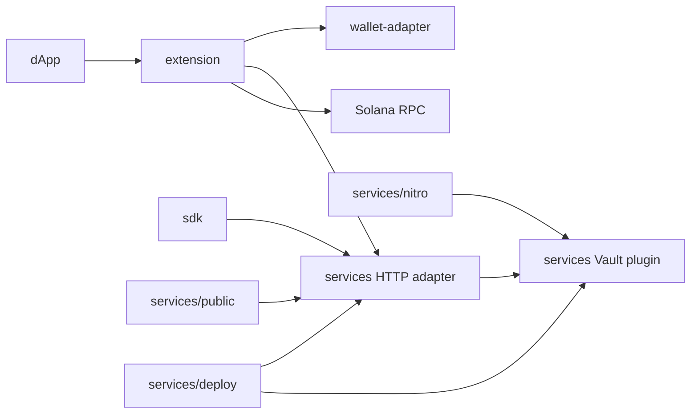

# Repository and branch inventory

Inventory date: **2026-08-30**.

The organization has eight public, non-archived repositories. All default to
`main`. The local checkouts are full clones with their remote branches and
tags, and the implementation described by these docs currently spans
uncommitted workspace changes in several repositories. Until those changes are
reviewed and committed, GitHub's `main` branches still show the earlier
prototype.

## Repositories

| Repository | Remote branches / history | Role and current workspace state |
| --- | --- | --- |
| [`.github`](https://github.com/Spiral-Safe/.github) | `main`; 3 commits | Organization profile and license. Its high-availability, Consul, monitoring, audit, rotation, and production-Nitro language remains aspirational. It should link to these capability boundaries before being used as product documentation. |
| [`extension`](https://github.com/Spiral-Safe/extension) | `main`; 7 commits | Manifest V3 Solana wallet. The workspace replaces local/browser-held signing keys and stub methods with a Vault-backed provider, session-only API token, origin/tab/frame-bound ceremonies, page-facing URL credential redaction, real Wallet Standard methods, RPC submission, tests, popup configuration, and an extension-side demo. |
| [`sdk`](https://github.com/Spiral-Safe/sdk) | `main`; 2 commits | Low-level TypeScript HTTP client. The workspace replaces the obsolete browser `X-Vault-Token` model with a tenant bearer token, chain/operation/ceremony fields, typed errors, URL safety checks, and route-contract tests. |
| [`services`](https://github.com/Spiral-Safe/services) | `main` (24 commits), `deployment`; 29 reachable commits total; tag `v1.0.0` | Runtime owner: Go Vault plugin, Express adapter, local-only service demo, Compose, tests, load harness, Skaffold/Kustomize manifests, and Veil/Nitro adapter. The workspace adds tenant/username authorization and validation, required WebAuthn user verification/counter defenses, one-time ceremonies, tenant/chain storage, Solana and Ethereum signers, Vault Raft deployment, and removes Nitriding from the enclave build path. |
| [`specs`](https://github.com/Spiral-Safe/specs) | `main`; 2 commits | Canonical architecture, API, inventory, runbook, security, and verification documentation in this workspace. The historical repository contained a short product overview and four roadmap issues. |
| [`token-list`](https://github.com/Spiral-Safe/token-list) | `main`; 379 commits | Inherited Jupiter Universal Token List data/tooling fork. Spiral-specific history adds/renames the S2 token. It is not imported by the signer, service, extension, or SDK. |
| [`wallet-adapter`](https://github.com/Spiral-Safe/wallet-adapter) | `main`; 5 commits | Private local package that translates the injected provider into Solana Wallet Standard accounts, events, legacy-transaction, batch, sign-and-send, message, SIWS, and custom registration/configuration features. It owns no credentials or keys. |
| [`website`](https://github.com/Spiral-Safe/website) | `main`; 6 commits | Legacy Hugo marketing site with the Terminal theme pinned as a Git submodule at `7e13d24`. It is separate from both runnable demos and from the currently hosted public marketing site. |

## Runtime dependency graph

Material relationships:

1. `extension/package.json` consumes `wallet-adapter` through
   `file:../wallet-adapter`; build the adapter first.
2. The extension, SDK, and `services/public` demo all implement the same
   five-route registration/signing contract.
3. `services/load-test` targets the adapter's probes and every wallet route.
4. `services/skaffold.yaml` builds the service, client, and Vault-plugin images
   for local development. Its production profile removes the client artifact,
   and the production overlay deletes every client/demo workload.
5. `services/nitro/Dockerfile` now builds the local plugin plus a pinned Veil
   source revision; it no longer fetches the historical `deployment` branch
   or Nitriding.
6. `website` pins an external Hugo theme submodule.

`.github`, `specs`, `token-list`, and `website` do not participate in
the signing request path.

## Services branch topology

`services/main` and `services/deployment` share commit `cdbe171`, then
diverge by five main-only and four deployment-only commits in the cloned
history:

- remote `main` contains the newest original local setup, Go tests, generic
  byte-signing fallback, and the old Nitriding template;
- remote `deployment` contains older hosted-origin/Vault/Nitro experiments;
- the current workspace implementation is based on the `main` checkout and
  supersedes both branch-specific deployment approaches with configurable
  WebAuthn origins, chain-specific signing, Kubernetes manifests, and Veil.

Do not merge `deployment` mechanically. Review individual historical changes
against the current architecture; its hard-coded origins and old enclave
assumptions are not production configuration.

## Product areas and ownership

| Product area | Current owner | Notes |
| --- | --- | --- |
| Key custody, WebAuthn validation, chain signing | `services` Go plugin | Security-critical core |
| HTTP auth, validation, Vault client | `services/src` | Tenant boundary and error contract |
| Solana dApp integration | `extension` + `wallet-adapter` | Extension only supports Solana |
| Direct application integration | `sdk` | Caller performs WebAuthn browser steps |
| Interactive examples | `services/public`, `extension/demo` | Service demo also exposes Ethereum |
| Local orchestration and load checks | `services` | Compose and bounded Node runners |
| Kubernetes operations | `services/deploy`, `services/skaffold.yaml` | Production-intent, external inputs required |
| Nitro/attestation experiment | `services/nitro` | Veil adapter; separate from Kubernetes |
| Canonical documentation | `specs` | This repository |
| Marketing/data assets | `website`, `.github`, `token-list` | Outside runtime |

## Roadmap issues versus workspace implementation

| Issue | Implemented now | Still absent |
| --- | --- | --- |
| [#1: browser extension](https://github.com/Spiral-Safe/specs/issues/1) | Backend-backed Wallet Standard discovery, registration, transaction/message signing, batch signing, send, SIWS, demo, and tests | balances/history/send UI, store release, user session issuance, production UX |
| [#2: SaaS/API product](https://github.com/Spiral-Safe/specs/issues/2) | Bearer-token mapping to tenant plus explicit username allowlist, exact CORS allowlist, request IDs, rate limit | OIDC/user sessions, token lifecycle UI/API, recovery, billing, alerts, global quotas |
| [#3: consumer passkey wallet](https://github.com/Spiral-Safe/specs/issues/3) | WebAuthn-gated wallets and browser demos | balances/history, QR/identifier transfers, sponsorship, on-ramp, localization, recovery |
| [#4: production deployment](https://github.com/Spiral-Safe/specs/issues/4) | Skaffold, Kubernetes security baseline, three-node Vault Raft, PVCs, KMS inputs, audit bootstrap, controlled joins | target-cloud deployment, backup/restore drills, monitoring/alerting, KMS recovery, DR, external audit |

## Repository health work still needed

- Add CI to the service, SDK, adapter, extension, deployment, and documentation
  repositories. Only `token-list` currently contains workflow files.
- Normalize licenses and package metadata. In particular, SDK/extension package
  declarations and repository license files need review; the wallet adapter is
  intentionally private and still needs a reviewed publish/provenance process.
- Add release provenance, SBOMs, signed images/packages, changelogs, and a
  cross-repository compatibility/version policy.
- Decide whether the consumer-wallet and enterprise signing-service stories
  are one product or separate products. The historical website/issues and
  organization profile still mix both.
- Replace stale organization-profile claims with links to the verified and
  pending capability lists in this repository.
